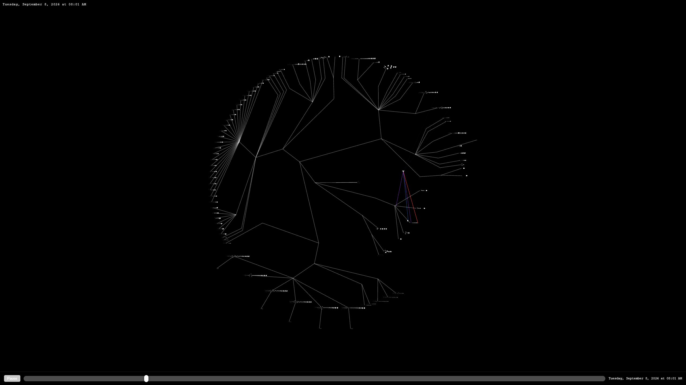
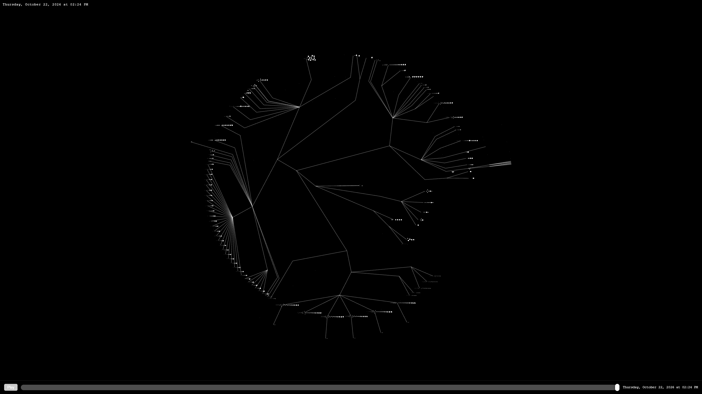

# phource

3D git commit history visualization combining gource's time-based animation with city-blocks' loc-proportional file volumes. Shows **which files are being churned** and **how branches diverge** — things gource cannot display.

## What problem does this solve?

A static bar chart tells you *how much* was committed. A gource animation tells you *when* files were touched. But neither tells you **which files are most actively churned** or **how two branches diverge**.

phource fills both gaps in a single 3D visualization:

- **File churn at a glance**: Each file is rendered as a 3D building whose size encodes cumulative lines of code × commit count. A heavily-modified file grows large and tall. A stale file stays small. One look tells you where the action is.
- **Branch comparison**: Compare two git branches side by side in a shared timeline. See where they diverge, which areas each branch touches, and how they might merge — without switching context.

## Features

- 3D city-blocks-style visualization with LOC-proportional file volumes
- Per-user avatar tracking with colored beams (green = add, purple = modify, red = delete)
- Time scrubbing and play/pause controls
- Predictive camera zoom with 5-commit lookahead
- Directory hover tooltips
- Multi-branch side-by-side comparison — load two branch logs to visualize them as two offset 3D tree universes in a shared timeline

## Quickstart

```bash
npm install
node index.js
```

Then open `http://localhost:3000` in your browser.

### Loading your git history

Generate a log from any git repository:

```bash
python scripts/generate-log.py /path/to/your/repo
```

### Comparing two branches

Generate logs for each branch and place them in `public/`:

```bash
python scripts/generate-log.py /path/to/repo --output public/phource.log
python scripts/generate-log.py /path/to/repo --branch feature-branch --output public/phource-branch.log
```

phource will automatically load both and display them side-by-side with dynamic offsetting based on each tree's bounding box.

## Screenshots



*Mid-animation: full git history of a 1882-commit repository (master branch). File buildings sized by churn, colored action beams (green=add, purple=modify, red=delete), user tracking triangle. No road crossings, no flickering.*



*Settled view after full simulation: 1638 file buildings rendered as pure white 3D volumes. Only 14 residual overlaps after 50 settle passes (down from 381 before fixes). Zero road crossings, zero JS errors.*

## How it works

phource reads an extended gource custom log format:

```
timestamp|username|action|filepath|loc|count|colour_hex|branch
```

- `timestamp` — Unix epoch seconds
- `username` — Git author name
- `action` — A (added), M (modified), D (deleted)
- `filepath` — Full path
- `loc` — Lines of code at that commit
- `count` — Cumulative commit count for that file
- `colour_hex` — Author's commit colour
- `branch` — Git branch name (8th field, added in v2)

Each file is rendered as a 3D box whose width/depth = `loc * count^(-p/2)` and height = `loc * count^p` (p=0.2). This means:
- **Large files** appear wide
- **Frequently-touched files** appear tall
- **Volume = loc³** — a single metric combining size and churn

### Branch comparison

When two log files are loaded (`phource.log` for `main` and `phource-branch.log` for a secondary branch), each branch's files are namespaced under a top-level directory named after the branch (e.g., `feature-branch/src/file.js`). After the orbital layout positions both trees, `offsetBranchTrees()` computes each subtree's bounding box and offsets them horizontally side-by-side with padding, so both trees are always visible without overlap.

The camera centers on the combined scene bounds, and the predictive zoom accounts for both trees' growth.

## Roadmap

- [ ] GitHub PR integration (contextual file history during review)
- [ ] Focus mode (highlight one user/team, dim others)

## License

MIT
